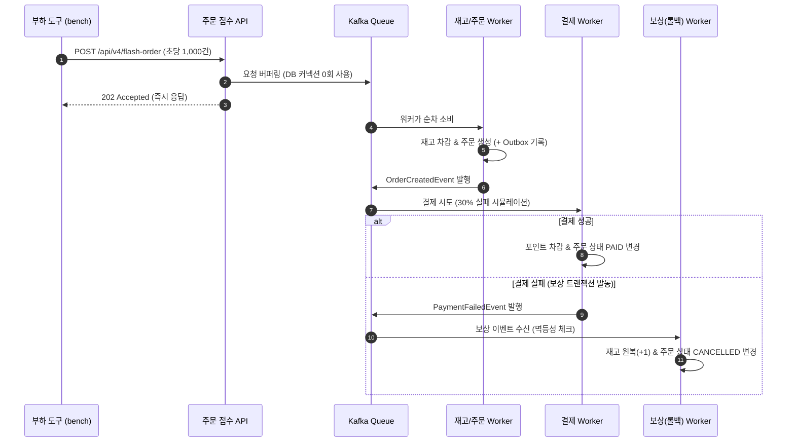

# 분산 시스템 한계 체감 & 극복 실습 설계서 (1단계 ~ 4단계)

[PURPOSE.md](PURPOSE.md)의 4단계 학습 로드맵을 **최소한의 코드 크기**와 **가장 직관적인 구조**로 구현하기 위한 구체화 문서입니다.  
여러 개의 무거운 프로젝트를 따로 만들지 않고, **하나의 도메인(선착순 한정 상품 주문 & 포인트 결제)**을 기준으로 `v1`부터 `v4`까지 엔드포인트/전략만 바꿔가며 **동일한 공용 부하 도구**로 벤치마크(커넥션 풀 고갈, 데드락, TPS, 데이터 정합성)를 직접 비교 분석할 수 있도록 설계했습니다.

---

## 1. 핵심 설계 원칙

1. **단일 도메인, 단계별 엔드포인트 분리 (`/api/v1` ~ `/api/v4`)**
   - 프로젝트를 4개로 쪼개지 않고 **단일 서버 애플리케이션 + 단일 `docker-compose.yml` (PostgreSQL + Kafka)**로 구성합니다.
   - 같은 테이블(`product`, `user_point`, `orders`, `processed_message`, `outbox_event`)을 공유하되, 단계별 API 경로만 다르게 호출하여 코드 비교와 벤치마크 대조가 한눈에 되도록 합니다.
2. **설치 불필요 공용 부하 & 벤치마크 도구 (`bench/bench.mjs`)**
   - 무거운 JMeter나 별도 설치가 필요한 k6 대신, Node.js 내장 `fetch` API를 활용한 **단일 스크립트 부하 도구 1개**만 제작하여 전 단계에서 공용으로 재사용합니다.
   - 부하 실행 중 서버의 **DB 커넥션 풀 상태(Active / Pending / Timeout)**와 **에러 유형(Deadlock 40P01, ConnectionTimeout)**을 실시간 수집하고, 종료 후 **데이터 정합성 검증 및 Markdown 비교 표**를 자동 출력합니다.
3. **의도적 병목 설정 (작은 스케일로 대용량 장애 증폭)**
   - 로컬 PC에서 수십만 건을 쏘지 않아도 물리적 한계를 즉시 관찰할 수 있도록 **DB 커넥션 풀 크기(`maximumPoolSize = 10`)**, **커넥션 타임아웃(`connectionTimeout = 1000ms`)**을 의도적으로 작게 조여 현상을 선명하게 증폭시킵니다.

---

## 2. 전체 아키텍처 및 프로젝트 폴더 구조

```mermaid
flowchart LR
    subgraph Bench["공용 부하 & 분석 도구 (bench)"]
        Runner["load-runner\n(동시 요청 생성 + 메트릭 수집)"]
        Report["benchmark-report.md\n(단계별 비교 분석표)"]
    end

    subgraph App["단일 실습 서버 (Spring Boot / Java 17)"]
        V1["1단계: /api/v1\n단일 RDBMS (Lock/Pool/Deadlock)"]
        V2["2단계: /api/v2\n비동기 큐 분리 & 멱등성"]
        V3["3단계: /api/v3\nDual-Write vs Transactional Outbox"]
        V4["4단계: /api/v4\nSaga 보상 트랜잭션 (최종 일관성)"]
        Metrics["/admin/metrics & /admin/verify\n(HikariCP, Deadlock, 정합성 체크)"]
    end

    subgraph Infra["Docker Compose"]
        DB[("PostgreSQL 16\n(Row Lock, 40P01)")]
        MQ[["Kafka\n(Commit Log / Consumer Group)"]]
    end

    Runner -->|HTTP 부하 전송| App
    Runner -->|폴링 & 검증| Metrics
    Runner -->|결과 기록| Report
    App -->|HikariCP (Max 10)| DB
    App <-->|Produce / Consume| MQ
```

### 최소한의 디렉터리 구조
```text
distributed-lab/
├── PURPOSE.md                   # 학습 동기 및 4단계 로드맵 가이드
├── PLAN.md                      # 현재 설계 문서
├── STUDY_GUIDE.md               # 핵심 코드 위치 및 핸즈온 학습 가이드
├── README.md                    # 전체 프로젝트 소개
├── docker-compose.yml           # PostgreSQL 16 + Kafka 3.7.0 (KRaft)
├── bench/
│   ├── bench.mjs                # 공용 부하 생성 + 실시간 커넥션 풀/데드락 수집기
│   └── results.md               # 자동 생성되는 단계별 벤치마크 비교 리포트
└── server/                      # 단일 Spring Boot 프로젝트
    ├── build.gradle
    └── src/main/
        ├── resources/application.yml
        └── java/lab/
            ├── domain/          # Product, UserPoint, Orders, ProcessedMessage, OutboxEvent
            ├── admin/           # 초기화(/reset), 커넥션 풀 모니터링(/metrics)
            ├── step1_rdbms/     # 1단계: Hot Row 락 경합, 데드락, 외부 API 지연으로 인한 풀 고갈
            ├── step2_async/     # 2단계: Kafka 비동기 분리, Consumer 오프셋, 멱등성(Idempotency)
            ├── step3_outbox/    # 3단계: Dual-Write 장애 재현 vs Transactional Outbox 패턴
            └── step4_saga/      # 4단계: 선착순 주문 접수 버퍼링 + 결제 실패 시 Saga 역방향 보상
```

---

## 3. 공통 데이터 모델 (최소 테이블 5개)

모든 단계에서 공통으로 사용하며, 테스트 시작 전 `/admin/reset` 호출 시 초기 상태로 리셋됩니다.

| 테이블명 | 주요 컬럼 | 용도 및 관찰 포인트 |
| :--- | :--- | :--- |
| `product` | `id`, `stock` | 단일 상품(Hot Row) 재고 차감 경합 및 교차 업데이트 데드락 재현 |
| `user_point` | `user_id`, `balance` | 결제 시 포인트 차감 및 4단계 Saga 보상 트랜잭션(환급) 확인 |
| `orders` | `id`, `user_id`, `product_id`, `status`, `tx_id` | 주문 상태(`PENDING`, `PAID`, `CANCELLED`) 변화 추적 |
| `processed_message` | `message_id (PK)`, `created_at` | 2~4단계 컨슈머 **멱등성(중복 처리 방지)** 보장용 테이블 |
| `outbox_event` | `id`, `aggregate_id`, `payload`, `status` | 3~4단계 **Transactional Outbox** 패턴용 이벤트 저장소 |

---

## 4. 단계별 상세 구현 및 실험 시나리오

### [1단계] RDBMS의 "물리적 한계" 체감하기 (`step1_rdbms`)

단일 `@Transactional` 안에서 모든 것을 처리할 때 왜 커넥션 풀이 마르고 데드락이 발생하는지 수치로 확인합니다.

#### 실험 1-A: Hot Row 비관적 락(`SELECT ... FOR UPDATE`) 경합
- **구현 (`POST /api/v1/orders/hot-lock`)**:
  - 1번 상품(`stock = 1000`) 하나에 동시 요청이 몰려 `SELECT ... FOR UPDATE`로 재고를 차감하고 행 잠금 유지 시간을 시뮬레이션(20ms 내부 연산).
- **관찰 포인트**:
  - 모든 요청이 단일 Row Lock 해제를 기다리면서 DB 커넥션을 점유한 채 줄을 섭니다.

#### 실험 1-B: 트랜잭션 내부 외부 API 호출로 인한 **커넥션 풀 고갈**
- **구현 (`POST /api/v1/orders/external-delay`)**:
  - `@Transactional` 내부에서 재고 차감 후 **가짜 외부 결제/알림 API(`Thread.sleep(300ms)`)**를 호출.
- **관찰 포인트**:
  - DB 자체의 쿼리는 1ms 만에 끝났음에도, 네트워크 I/O 대기 동안 커넥션을 반납하지 못해 HikariCP `active=10(Max)`, `pending=수십 개`로 치솟으며 **`SQLTransientConnectionException (Connection is not available, request timed out)`** 대량 발생.

#### 실험 1-C: 다중 리소스 잠금 순서 역전으로 인한 **데드락(Deadlock)**
- **구현 (`POST /api/v1/orders/deadlock`)**:
  - 짝수 요청은 `상품 1번 락 -> 상품 2번 락` 순서로 갱신
  - 홀수 요청은 `상품 2번 락 -> 상품 1번 락` 순서로 갱신
- **관찰 포인트**:
  - PostgreSQL이 순환 대기를 감지하고 한쪽 트랜잭션을 강제 희생시키며 **`CannotAcquireLockException` (SQLState `40P01`, `deadlock detected`)** 발생.
- **해결 (`POST /api/v1/orders/deadlock-fixed`)**:
  - 항상 ID 오름차순(`Math.min(idA, idB) -> Math.max(idA, idB)`)으로 정렬하여 락을 획득하도록 수정한 엔드포인트로, 데드락이 `0건`으로 해결됨을 확인.

---

### [2단계] "비동기 분리"와 메시지 큐 (`step2_async`)

"지금 당장 해야 할 일(주문 접수)"과 "나중에 해도 되는 일(포인트 차감, 알림 발송)"을 분리하여 커넥션 풀 점유 시간을 극단적으로 줄입니다.

#### 실험 2-A: 동기 처리(v1) vs 비동기 큐 분리(v2) 성능 비교
- **구현 (`POST /api/v2/orders/async`)**:
  - API 스레드는 `orders` 테이블에 `PENDING` 상태로만 `INSERT`(수 ms 소요)하고 즉시 커넥션 반납 후 Kafka `order-created-v2` 토픽에 메시지 발행.
  - 백그라운드 Consumer가 메시지를 읽어 외부 API 호출(300ms 지연) 및 후속 처리를 수행.
- **관찰 포인트**:
  - 1-B와 똑같은 300ms 지연이 존재함에도, API 응답 시간은 수 ms로 떨어지고 **HikariCP 커넥션 풀 타임아웃이 0건**이 되는 것을 1-B와 직접 비교합니다.

#### 실험 2-B: 중복 발행/재시도 상황에서의 **멱등성(Idempotency)** 검증
- **구현 (`POST /api/v2/orders/duplicate-test`)**:
  - 네트워크 타임아웃으로 인해 프로듀서 또는 컨슈머가 **동일한 `txId` 메시지를 2번 연속 전달**하는 상황을 시뮬레이션.
  - `idempotent=false` 모드: 포인트/쿠폰이 **2번 중복 차감**됨.
  - `idempotent=true` 모드: DB 트랜잭션 내에서 `processed_message` 테이블에 `txId`를 `INSERT` 시도하여 유니크 제약 조건(`DataIntegrityViolationException`)으로 중복 처리를 완벽 차단.

---

### [3단계] 분산 환경에서의 데이터 정합성: Dual-Write vs Outbox (`step3_outbox`)

DB와 Kafka 두 곳에 데이터를 쓸 때 발생하는 **이중 쓰기(Dual-Write) 정합성 깨짐**을 재현하고 **Transactional Outbox 패턴**으로 해결합니다.

#### 실험 3-A: Dual-Write 장애 재현 (`POST /api/v3/orders/dual-write?failRate=0.2`)
- **구현**:
  - DB에 주문을 저장(`COMMIT`)한 직후 Kafka 발행을 시도할 때, **20% 확률로 브로커 네트워크 예외**를 강제 발생시킵니다.
- **관찰 포인트**:
  - 부하 테스트 종료 후 `/api/v3/orders/verify`를 조회하면 **`DB에 저장된 주문 수 != Kafka로 발행된 이벤트 수`** 불일치(유실된 주문)가 발생한 것을 수치로 확인합니다.

#### 실험 3-B: Transactional Outbox 패턴 (`POST /api/v3/orders/outbox?failRate=0.2`)
- **구현**:
  - 비즈니스 스레드는 **단일 로컬 DB 트랜잭션** 안에서 `orders` INSERT와 `outbox_event (status=INIT)` INSERT만 함께 커밋합니다.
  - 별도 `Step3OutboxRelayScheduler`가 0.5초마다 `INIT` 상태의 이벤트를 읽어 Kafka로 발행하고 `PUBLISHED`로 변경합니다 (20% 전송 실패가 나도 다음 주기에 재시도).
- **관찰 포인트**:
  - 동일한 20% 브로커 장애율 조건에서도 수 초 뒤 **`DB 주문 수 == Kafka 이벤트 수 == 100% 일치`**함을 검증합니다.

---

### [4단계] 종합 토이 프로젝트: 선착순 주문 버퍼링 & Saga 보상 트랜잭션 (`step4_saga`)

1~3단계에서 배운 기법을 모두 결합하여 초당 1,000건 이상의 요청을 안전하게 흡수하고, 부분 실패 시 비동기 역방향 롤백(Saga)으로 최종 일관성(Eventual Consistency)을 맞춥니다.



#### 실험 4-A: Kafka 버퍼링 + 유량 제어 워커
- 앞단에서 요청을 큐로 버퍼링하고 워커가 일정 처리율로 소비하여, 동시 요청 폭주 시에도 DB 커넥션 풀(`Max 10`)이 평온하게 유지되는 것을 확인합니다.

#### 실험 4-B: Saga Choreography 역방향 보상 트랜잭션 검증
- 요청 중 **30%는 결제 게이트웨이 오류**가 나도록 설정합니다.
- 모든 이벤트 처리가 끝난 후 `/api/v4/verify-saga`를 통해 아래 **불변식(Invariant)**이 100% 성립하는지 검증합니다:
  - `차감된 총 재고 수 == 최종 PAID 상태인 주문 수`
  - `실패한 주문(CANCELLED)에 의해 묶였던 재고는 100% 원복됨`
  - `isConsistent: true`

---

## 5. 공용 부하 도구(`bench.mjs`) 및 벤치마크 리포트 설계

부하 도구는 단 하나의 파일(`bench/bench.mjs`)로 작성하며, 다음과 같이 CLI 옵션만으로 모든 단계의 테스트를 수행합니다.

### 실행 명령어 예시
```bash
# 전체 단계 연속 벤치마크 실행 및 비교 리포트(results.md) 자동 생성
node bench/bench.mjs --all

# 특정 시나리오만 단독 실행 (동시성 50, 총 요청 200건)
node bench/bench.mjs --scenario step1-delay          --concurrency 50 --requests 150
node bench/bench.mjs --scenario step1-deadlock       --concurrency 20 --requests 100
node bench/bench.mjs --scenario step1-deadlock-fixed --concurrency 20 --requests 100
node bench/bench.mjs --scenario step2-async          --concurrency 50 --requests 200
node bench/bench.mjs --scenario step3-dual-write     --concurrency 20 --requests 100
node bench/bench.mjs --scenario step3-outbox         --concurrency 20 --requests 100
node bench/bench.mjs --scenario step4-saga           --concurrency 30 --requests 100
```

### 서버가 노출하는 벤치마크 계측 API (`/admin/metrics` & `/admin/verify`)
- **커넥션 풀 지표 (1단계 병목 관찰용)**:
  - `peakActiveConnections` (부하 중 최대 활성 커넥션 수)
  - `peakThreadsAwaitingConnection` (커넥션을 얻기 위해 대기한 최대 스레드 수)
  - `connectionTimeoutCount` (`SQLTransientConnectionException` 발생 횟수)
- **락 & 데드락 지표 (1단계 병목 관찰용)**:
  - `deadlockCount` (PostgreSQL Error 40P01 / Deadlock 예외 발생 횟수)
- **비동기 큐 적체(Consumer Lag) 및 소화 지표 (2~4단계 버퍼링 관찰 및 완료 대기용)**:
  - `currentQueueLag` / `peakQueueLag` (큐에 쌓여 아직 워커가 처리하지 못한 현재/최대 미처리 메시지 수 + 미발행 Outbox 수)
  - `queueDrainTimeMs` (API 부하 전송이 끝난 시점부터 백그라운드 워커가 적체된 큐(`Lag = 0`)를 모두 소화하기까지 걸린 시간)
- **정합성 검증 지표**:
  - `initialStock`, `currentStock`, `paidOrders`, `cancelledOrders`, `publishedEvents`, `isConsistent (true/false)`

### 자동 생성될 벤치마크 비교 표 예시 (`bench/results.md`)

| 시나리오 | API TPS | API P95 지연 | DB 최대 대기 스레드 | 커넥션 타임아웃 | 데드락 | 큐 최대 적체(Peak Lag) | 큐 소화 시간(Drain) | 최종 정합성 |
| :--- | ---: | ---: | ---: | ---: | ---: | ---: | ---: | :---: |
| **1-A. 비관적 락 (Hot Row)** | ~180 | 420ms | 85 | 12건 | 0건 | - (동기) | - | O |
| **1-B. 외부 API 지연 (Pool 고갈)** | ~30 | 1,050ms | **190** | **415건** | 0건 | - (동기) | - | O |
| **1-C. 교차 락 (Deadlock 발생)** | ~210 | 310ms | 40 | 0건 | **68건** | - (동기) | - | O |
| **1-D. 락 순서 정렬 (Deadlock 해결)** | ~260 | 240ms | 45 | 0건 | **0건** | - (동기) | - | O |
| **2-A. 비동기 큐 분리 (Kafka)** | **~1,450** | **18ms** | **2** | **0건** | 0건 | **~820건** | ~3.2s | O |
| **2-B. 중복 메시지 (멱등성 미적용)** | ~1,200 | 22ms | 3 | 0건 | 0건 | ~450건 | ~1.8s | **X (중복차감)** |
| **2-C. 중복 메시지 (멱등성 적용)** | ~1,150 | 25ms | 3 | 0건 | 0건 | ~460건 | ~1.9s | **O** |
| **3-A. Dual-Write (20% 장애)** | ~950 | 30ms | 4 | 0건 | 0건 | ~380건 | ~1.5s | **X (유실발생)** |
| **3-B. Transactional Outbox** | ~910 | 32ms | 4 | 0건 | 0건 | ~510건 | ~2.8s | **O (100% 일치)** |
| **4. 버퍼링 + Saga 보상 트랜잭션** | **~1,600** | **15ms** | **3** | **0건** | **0건** | **~1,250건** | ~4.5s | **O (보상완료)** |
