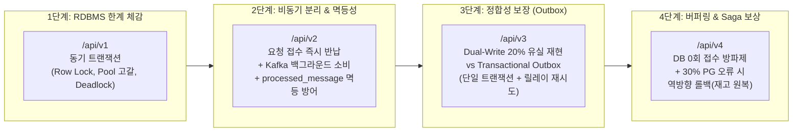

# 🚀 Distributed Lab: RDBMS의 한계에서 출발하는 분산 시스템 실습실

> **"RDBMS의 물리적 한계를 직접 마주하고, 이를 해결하는 패턴(비동기 분리, Outbox, Saga)을 단계별로 확장하며 체득한다."**

대규모 트래픽 환경에서 단일 RDBMS의 트랜잭션(`@Transactional`)이 왜 멈추는지 **의도적인 병목(커넥션 풀 10개 제한, 데드락 유발, 지연 주입)**을 통해 눈으로 직접 확인하고, 이를 **Kafka 메시지 큐, 멱등성 설계, Transactional Outbox 패턴, Saga 보상 트랜잭션**으로 점진적으로 극복해 나가는 핸즈온 토이 프로젝트입니다.

---

## 📌 주요 특징 (Key Features)

1. **최소한의 크기, 직관적인 구조**
   - 수십 개의 마이크로서비스로 쪼개지 않고, **단일 Spring Boot 서버 + 단일 Docker Compose(PostgreSQL + Kafka)** 환경에서 단계별 패키지(`v1` ~ `v4`)만 분리하여 코드와 원리를 한눈에 비교할 수 있습니다.
2. **의도적인 병목 설정 (작은 스케일로 대용량 장애 증폭)**
   - HikariCP 커넥션 풀 크기를 **10개**, 타임아웃을 **1,000ms**로 강제 제한하여, 로컬 환경에서 수십~수백 건의 요청만으로도 커넥션 풀 고갈과 데드락을 선명하게 관찰할 수 있습니다.
3. **설치 불필요 공용 부하 & 분석 도구 (`bench/bench.mjs`)**
   - JMeter, k6 같은 무거운 외부 툴 없이 **Node.js 내장 `fetch`**만으로 동작하는 단일 스크립트 도구를 제공합니다.
   - 50ms 주기로 서버의 DB 커넥션 풀 상태(Active/Pending)와 데드락(40P01), 타임아웃을 실시간 수집하고, [bench/results.md](bench/results.md)에 Markdown 비교 표를 자동 생성합니다.

---

## 🛠️ 기술 스택 (Tech Stack)

| 구분 | 기술 / 도구 | 용도 |
| :--- | :--- | :--- |
| **Backend** | Java 17, Spring Boot 3.2.5, Spring Data JPA, Spring Kafka, Lombok | 실습 서버 애플리케이션 |
| **Database** | PostgreSQL 16 (Alpine) | Row-Level Lock, 40P01 데드락, 데이터 영속화 |
| **Broker** | Apache Kafka 3.7.0 (KRaft 모드) | Zookeeper 없는 단일 브로커, 비동기 버퍼링 및 이벤트 릴레이 |
| **Benchmark** | Node.js (v18+ 내장 `fetch`) | Worker Pool 동시성 제어 부하 테스트 & 메트릭 수집기 |
| **Infra** | Docker & Docker Compose | 인프라 원클릭 구동 |

---

## 🚦 단계별 학습 로드맵 (Step 1 ~ 4)



### [1단계] RDBMS의 물리적 한계 (`lab.step1_rdbms`)
- **1-A. Hot Row 비관적 락 경합 (`POST /api/v1/orders/hot-lock`)**: 단일 상품 행에 `PESSIMISTIC_WRITE` 락을 걸고 대기열 발생 관찰.
- **1-B. 트랜잭션 내 외부 API 호출 참사 (`POST /api/v1/orders/external-delay`)**: 300ms 네트워크 지연 동안 DB 커넥션을 반납하지 못해 10개 풀이 즉시 고갈(`ConnectionTimeoutException`)되는 현상 재현.
- **1-C. 교차 락 데드락 (`POST /api/v1/orders/deadlock`)**: `[A -> B]`, `[B -> A]` 순서로 교차 잠금을 획득하여 PostgreSQL 순환 대기 데드락(SQLState `40P01`) 유발.
- **1-D. 락 순서 정렬 해결 (`POST /api/v1/orders/deadlock-fixed`)**: ID 오름차순 정렬만으로 데드락을 0건으로 완전 해결.

### [2단계] 비동기 분리와 메시지 큐 (`lab.step2_async`)
- **2-A. 비동기 큐 분리 (`POST /api/v2/orders/async`)**: API는 `PENDING` 저장 후 즉시 커넥션 반납(`202 Accepted`). 백그라운드 컨슈머가 DB 커넥션 없이 300ms 지연을 대기한 뒤 `PAID` 갱신 $\rightarrow$ 커넥션 타임아웃 0건 달성.
- **2-B/C. 멱등성 검증 (`POST /api/v2/orders/duplicate-test`)**: 네트워크 재시도로 동일 메시지가 2회 도착했을 때, `processed_message`의 PK 제약조건으로 중복 처리 방어.

### [3단계] 분산 정합성: Dual-Write vs Outbox (`lab.step3_outbox`)
- **3-A. Dual-Write 장애 (`POST /api/v3/orders/dual-write?failRate=0.2`)**: DB 커밋 후 Kafka 전송 중 20% 장애 발생 시, DB에는 주문이 남지만 Kafka 이벤트는 영구 유실되는 불일치 재현.
- **3-B. Transactional Outbox 패턴 (`POST /api/v3/orders/outbox`)**: 단일 로컬 트랜잭션 안에 `orders`와 `outbox_event (INIT)`를 원자적 저장하고, 스케줄러가 0.5초마다 실패 건을 무한 재시도하여 100% 일치 달성.

### [4단계] 선착순 버퍼링 & Saga 보상 트랜잭션 (`lab.step4_saga`)
- **선착순 방파제 (`POST /api/v4/flash-order`)**: DB 통신을 **0회**로 제한하고 Kafka로 즉시 버퍼링하여 초당 1,000건 이상의 요청을 무손실 흡수.
- **Saga Choreography 보상 트랜잭션**: 재고 워커(차감) $\rightarrow$ 결제 워커(30% PG 오류 모의) $\rightarrow$ 보상 워커(재고 `+1` 원복 & 주문 `CANCELLED`) 흐름을 통해 최종 일관성(Eventual Consistency) 완벽 증명.

---

## 📊 종합 벤치마크 결과 비교 분석

실제 로컬 환경에서 [bench/bench.mjs](bench/bench.mjs)를 구동하여 측정한 단계별 성능 및 정합성 지표입니다.

| 단계 및 시나리오 | 동시성 / 요청수 | TPS | P95 지연 | DB 대기 풀 | 타임아웃 / 데드락 | 데이터 정합성 | 핵심 교훈 |
| :--- | :---: | ---: | ---: | :---: | :---: | :---: | :--- |
| **1-A. 비관적 락 (Hot Row)** | 50 / 200 | 34.8 | 1,860ms | **40** (Max 10) | **123건 타임아웃** | O | 단일 행 락 경합 시 DB 풀이 말라버림 |
| **1-B. 외부 API 지연 (동기)** | 50 / 150 | 20.6 | **4,252ms** | **40** (Max 10) | **128건 타임아웃** | O | 트랜잭션 내 300ms 대기로 85% 요청 탈락 |
| **1-C. 교차 락 (데드락)** | 20 / 100 | 9.8 | 4,055ms | 10 (Max 10) | **50건 데드락 (40P01)** | O | 역순 잠금 획득으로 순환 대기 발생 |
| **1-D. 락 순서 정렬 (해결)** | 20 / 100 | **26.6** | **791ms** | 10 (Max 10) | **0건 (100% 성공)** | O | ID 오름차순 정렬만으로 데드락 원천 차단 |
| **2-A. 비동기 큐 분리 (Kafka)** | 50 / 200 | **118.9** | **548ms** | **즉시 반납** | **0건** | O | 300ms 지연에도 커넥션 타임아웃 0건 달성 |
| **2-B. 중복 메시지 (멱등성 OFF)** | 20 / 50 | 215.4 | 89ms | 여유 | 0건 | **X (중복 처리)** | 네트워크 재시도 시 이중 결제 위험 |
| **2-C. 중복 메시지 (멱등성 ON)** | 20 / 50 | 221.0 | 97ms | 여유 | 0건 | **O (중복 차단)** | `processed_message`로 안전하게 SKIP |
| **3-A. Dual-Write 장애 (20%)** | 20 / 100 | 189.0 | 229ms | 여유 | 16건 전송 에러 | **X (16건 영구 유실)** | DB 커밋 후 Kafka 실패 시 데이터 파괴 |
| **3-B. Transactional Outbox** | 20 / 100 | **257.7** | **99ms** | 여유 | **0건** | **O (100% 일치)** | 단일 트랜잭션 저장 + 릴레이 무한 재시도 |
| **4. 선착순 버퍼링 & Saga 보상** | 30 / 100 | **998.3** | **39.9ms** | **0 대기 (풀 평온)** | **0건** | **O (보상 복구 완료)** | **방파제 버퍼링 + 역방향 롤백으로 최종 일관성** |

<details>
<summary><b>📜 bench/results.md 전체 원본 실행 로그 펼치기</b></summary>

```markdown
| 실행일시 | 시나리오 | Concurrency / Req | TPS | P95 지연 | DB 최대 대기 스레드 | 커넥션 타임아웃 | 데드락 | 성공 / 404 / 기타에러 |
| :--- | :--- | :---: | ---: | ---: | ---: | ---: | ---: | :---: |
| 2026-10-29 07:21:57 | **1-A. 비관적 락 (Hot Row)** | 50 / 200 | 34.8 | 1860.5ms | 40 | 123건 | 0건 | 77 / 0 / 0 |
| 2026-10-29 07:22:10 | **1-B. 외부 API 지연 (Pool 고갈)** | 50 / 150 | 20.6 | 4252.5ms | 40 | 128건 | 0건 | 22 / 0 / 0 |
| 2026-10-29 07:22:26 | **1-C. 교차 락 (Deadlock 발생)** | 20 / 100 | 9.8 | 4055.0ms | 10 | 47건 | 50건 | 3 / 0 / 0 |
| 2026-10-29 07:22:38 | **1-D. 락 순서 정렬 (Deadlock 해결)** | 20 / 100 | 26.6 | 791.4ms | 10 | 0건 | 0건 | 100 / 0 / 0 |
| 2026-10-29 07:25:51 | **2-A. 비동기 큐 분리 (Kafka)** | 50 / 200 | 118.9 | 548.3ms | 40 | 0건 | 0건 | 200 / 0 / 0 |
| 2026-10-29 07:25:56 | **2-B. 중복 메시지 (멱등성 미적용)** | 20 / 50 | 215.4 | 89.4ms | 8 | 0건 | 0건 | 50 / 0 / 0 |
| 2026-10-29 07:26:00 | **2-C. 중복 메시지 (멱등성 적용)** | 20 / 50 | 221.0 | 97.3ms | 10 | 0건 | 0건 | 50 / 0 / 0 |
| 2026-10-29 07:26:16 | **2-A. 비동기 큐 분리 (Kafka)** | 10 / 30 | 186.2 | 54.1ms | 0 | 0건 | 0건 | 30 / 0 / 0 |
| 2026-10-29 07:31:29 | **3-A. Dual-Write (20% 장애)** | 20 / 100 | 189.0 | 229.7ms | 10 | 0건 | 0건 | 84 / 0 / 16 |
| 2026-10-29 07:31:40 | **3-B. Transactional Outbox** | 20 / 100 | 257.7 | 99.9ms | 9 | 0건 | 0건 | 100 / 0 / 0 |
| 2026-10-29 07:36:01 | **4. 버퍼링 + Saga 보상 트랜잭션** | 50 / 300 | 1052.5 | 126.4ms | 0 | 0건 | 0건 | 300 / 0 / 0 |
| 2026-10-29 07:37:51 | **4. 버퍼링 + Saga 보상 트랜잭션** | 30 / 100 | 586.9 | 117.8ms | 0 | 0건 | 0건 | 100 / 0 / 0 |
| 2026-10-29 07:38:28 | **4. 버퍼링 + Saga 보상 트랜잭션** | 30 / 100 | 998.3 | 39.9ms | 0 | 0건 | 0건 | 100 / 0 / 0 |
```
</details>

---

## ⚡ 빠른 시작 (Quick Start)

### 1. 인프라 실행 (PostgreSQL 16 & Kafka KRaft)
```bash
docker compose up -d
```

### 2. Spring Boot 서버 실행
```bash
# 루트 또는 server 디렉터리에서 실행
gradle :server:bootRun
```
* 서버 정상 기동 확인: `curl http://localhost:8080/admin/metrics`

### 3. 부하 테스트 도구 실행 (`bench/bench.mjs`)
별도 npm 설치 없이 로컬 Node.js(v18 이상)로 즉시 실행됩니다.

```bash
# 1단계: 외부 API 지연으로 인한 풀 고갈 체감
node bench/bench.mjs --scenario step1-delay --concurrency 50 --requests 150

# 1단계: 데드락 발생 vs 락 정렬 해결 비교
node bench/bench.mjs --scenario step1-deadlock --concurrency 20 --requests 100
node bench/bench.mjs --scenario step1-deadlock-fixed --concurrency 20 --requests 100

# 2단계: 비동기 큐 분리 성능 확인
node bench/bench.mjs --scenario step2-async --concurrency 50 --requests 200

# 3단계: Dual-Write 유실 vs Outbox 재시도 정합성 비교
node bench/bench.mjs --scenario step3-dual-write --concurrency 20 --requests 100
curl http://localhost:8080/api/v3/orders/verify

node bench/bench.mjs --scenario step3-outbox --concurrency 20 --requests 100
curl http://localhost:8080/api/v3/orders/verify

# 4단계: 선착순 1,000 TPS 버퍼링 및 Saga 보상 트랜잭션 검증
node bench/bench.mjs --scenario step4-saga --concurrency 30 --requests 100
curl http://localhost:8080/api/v4/verify-saga
```

---

## 📁 디렉터리 구조 (Project Structure)

```text
distributed-lab/
├── PURPOSE.md                   # 학습 동기 및 4단계 로드맵 가이드
├── PLAN.md                      # 전체 아키텍처 및 세부 설계서
├── STUDY_GUIDE.md               # 💡 핵심 코드 줄 위치 및 직접 해보는 핸즈온 미션
├── README.md                    # 메인 소개 문서
├── docker-compose.yml           # PostgreSQL 16 + Kafka 3.7.0 (KRaft)
├── bench/
│   ├── bench.mjs                # 공용 부하 생성기 & 실시간 HikariCP/에러 수집기
│   └── results.md               # 자동 누적되는 벤치마크 결과 리포트 원본
└── server/                      # Spring Boot 단일 모듈
    ├── build.gradle
    └── src/main/
        ├── resources/application.yml # HikariCP pool=10, timeout=1000ms 강제 제한
        └── java/lab/
            ├── DistributedLabApplication.java
            ├── domain/          # Product, UserPoint, Orders, ProcessedMessage, OutboxEvent (공통 엔티티 5개)
            ├── admin/           # /admin/reset (초기화), /admin/metrics (커넥션 풀 모니터링)
            ├── step1_rdbms/     # 1단계: 비관적 락 경합, 풀 고갈, 순환 데드락(40P01)
            ├── step2_async/     # 2단계: Kafka 비동기 분리, 컨슈머 멱등성 필터
            ├── step3_outbox/    # 3단계: Dual-Write 20% 장애 vs Transactional Outbox 릴레이
            └── step4_saga/      # 4단계: 선착순 요청 버퍼링 + Choreography Saga 보상 트랜잭션
```

---

## 📖 추천 학습 가이드
- **[STUDY_GUIDE.md](STUDY_GUIDE.md)**: 각 단계별로 "반드시 봐야 할 핵심 코드 줄"과 "코드를 직접 고쳐서(망가뜨려서) 버그를 눈으로 확인하는 미션" 가이드.
- **[NEXT_STEPS.md](NEXT_STEPS.md)**: 💡 Redis 분산 락, 서킷 브레이커 & DLQ, Debezium CDC, 분산 트레이싱으로 이어지는 다음 단계 심화 로드맵.
